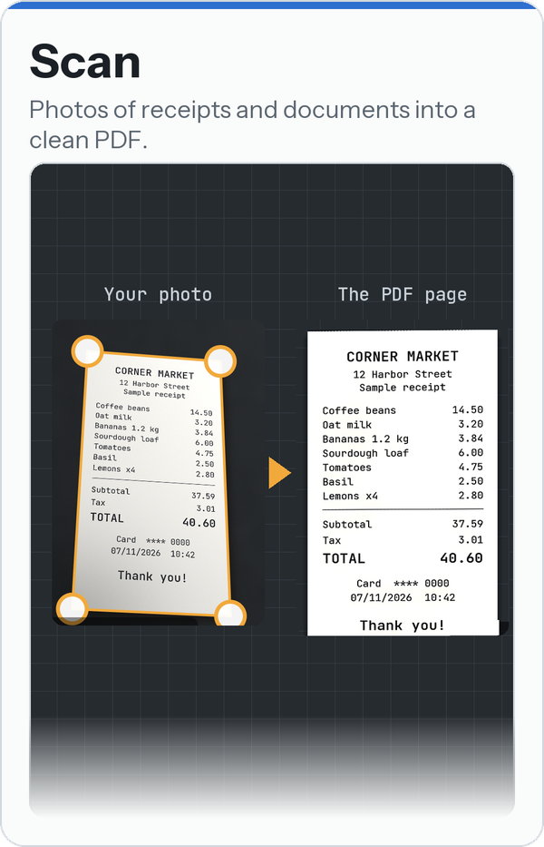
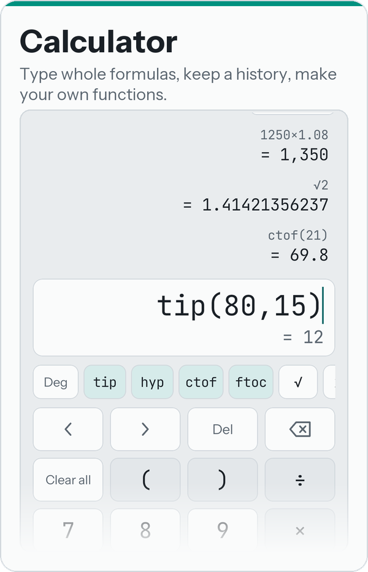
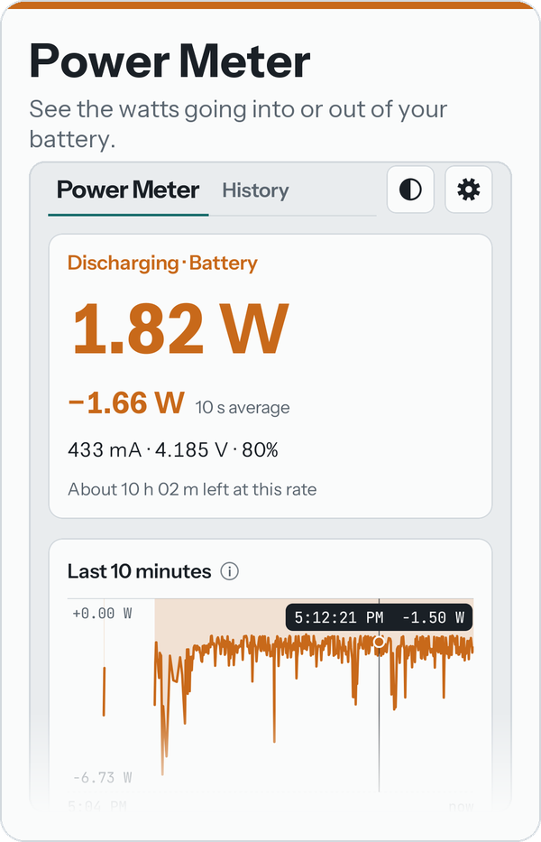
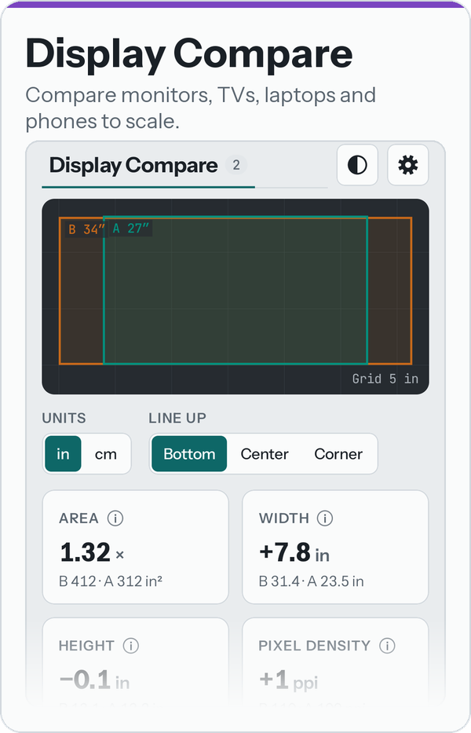
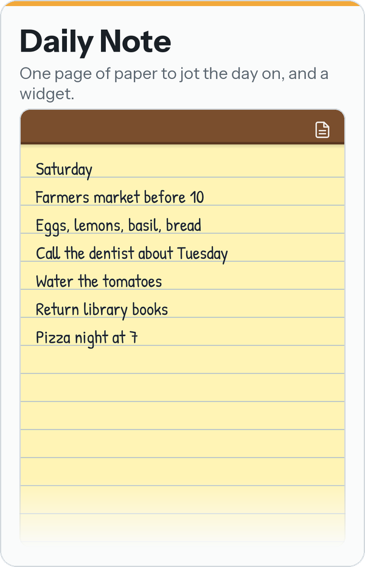

# Mini Apps

**Small, plain Android apps for phones and tablets.** Free, no ads, no accounts, no tracking.
Each does one job; all of them share one look, and each updates itself from here.

## The apps

<p align="center">
  <a href="https://github.com/whatwhatwhoa/MiniApps/releases?q=Scan&expanded=true"></a>
  <a href="https://github.com/whatwhatwhoa/MiniApps/releases?q=Calculator&expanded=true"></a>
  <a href="https://github.com/whatwhatwhoa/MiniApps/releases?q=Power+Meter&expanded=true"></a>
  <a href="https://github.com/whatwhatwhoa/MiniApps/releases?q=Display+Compare&expanded=true"></a>
  <a href="https://github.com/whatwhatwhoa/MiniApps/releases?q=Daily+Note&expanded=true"></a>
</p>

Tap a card to download that app; each app's guide is in the table below.

## Download

| App | What it does | Download | Guide |
|---|---|---|---|
| **Scan** | Photos of receipts and documents into a clean PDF: edges found, shadows gone, all on the phone | [⬇ APK](https://github.com/whatwhatwhoa/MiniApps/releases?q=Scan&expanded=true) | [README](apps/scan/README.md) |
| **Calculator** | A calculator you type formulas into: history, a real cursor, your own functions | [⬇ APK](https://github.com/whatwhatwhoa/MiniApps/releases?q=Calculator&expanded=true) | [README](apps/calculator/README.md) |
| **Power Meter** | See the watts going into or out of your battery: charging speed, drain, history, alerts | [⬇ APK](https://github.com/whatwhatwhoa/MiniApps/releases?q=Power+Meter&expanded=true) | [README](apps/powermeter/README.md) |
| **Display Compare** | Compare display sizes to scale: monitors, TVs, laptops, tablets, phones | [⬇ APK](https://github.com/whatwhatwhoa/MiniApps/releases?q=Display+Compare&expanded=true) | [README](apps/displaycompare/README.md) |
| **Daily Note** | One page of paper to jot the day on, and a full-page widget | [⬇ APK](https://github.com/whatwhatwhoa/MiniApps/releases?q=Daily+Note&expanded=true) | [README](apps/dailynote/README.md) |

Android 12 or newer. Every release of every app is on this repo's
[releases page](https://github.com/whatwhatwhoa/MiniApps/releases).

## Install

1. On your phone, open the app's download link and tap its **…apk** under *Assets* (the top
   one is the newest).
2. Open the downloaded file. If Android asks, allow installs from your browser (*Allow from
   this source*), then go back and tap **Install**.
3. If Play Protect warns that it doesn't know the app, tap **More details → Install anyway**.

**Updates:** each app checks this repo for a newer release (at most once a day, and on
**Settings → Updates → Check for updates**) and installs it when you tap **Update**; Android
asks first, and the app's data stays. That check is the only thing these apps do online; it
can be turned off in the same card. Installing a newer APK over the old one by hand works too.

## Building them yourself

With JDK 21 and the Android SDK (platform 37), from this folder:

```
./gradlew :calculator:assembleDebug          # one app (scan, calculator, powermeter, dailynote, displaycompare)
./gradlew assembleDebug                      # every app
./gradlew :calculator:testDebugUnitTest      # the Calculator's formula tests (:scan has its own too)
```

The APKs land in `apps/<app>/build/outputs/apk/`. Kotlin and Jetpack Compose; the shared look is
the `stack` module, the updates from GitHub the `update` module.

## License

[MIT](LICENSE). The fonts are under the SIL Open Font License: Instrument Sans and JetBrains
Mono (`stack/licenses/`), and Daily Note's Patrick Hand (`apps/dailynote/licenses/`).
