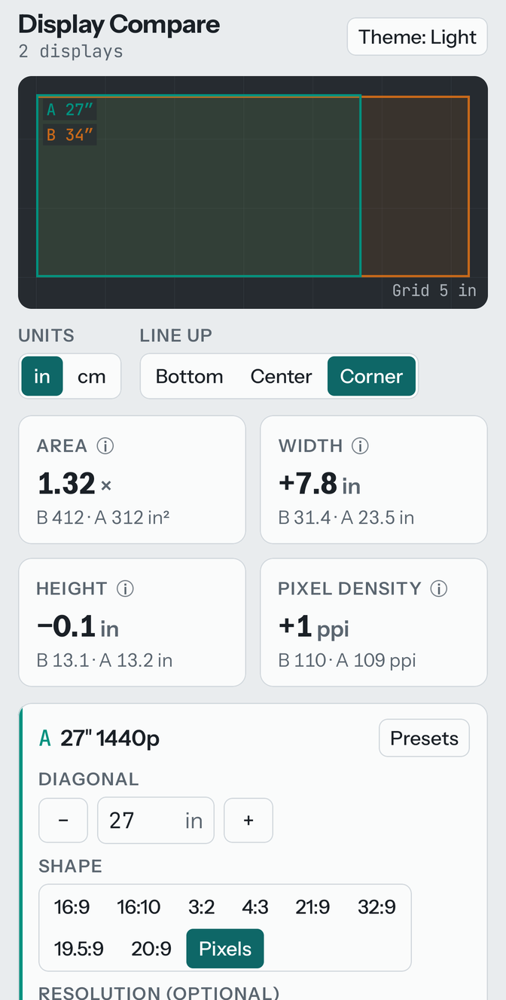

# Display Compare

**Compare display sizes to scale on your Android phone: monitors, TVs, laptops, tablets and
phones, side by side.**

### [⬇ Download the APK](https://github.com/whatwhatwhoa/MiniApps/releases/tag/displaycompare-v0.1.3)

Free, no ads, no account. Android 12 or newer. Part of the [Mini Apps](../../README.md)
series. Its only internet use is checking GitHub for its own updates.

<p align="center">
  
</p>

## Install

1. On your phone, open the download link above and tap **DisplayCompare-…apk** under *Assets*.
2. Open the downloaded file. If Android asks, allow installs from your browser (*Allow from
   this source*), then go back and tap **Install**.
3. If Play Protect warns that it doesn't know the app, tap **More details → Install anyway**.
4. Open **Display Compare**.

**Updating:** when a newer release is out, a note at the top says so: tap **Update to …**;
Android asks before it installs, and your displays stay. The **Updates** card behind the gear
(top right) has **Check for updates** and the once-a-day check (switch it off to stop it).

## Using it

The screen, top to bottom:
- **The mat**: every display drawn to the same scale. The grid is in real units; its step is
  in the corner ("Grid 5 in").
- **Units** (in / cm) and **Line up** (Bottom, as on a desk; Center; Corner).
- **Four tiles** comparing two displays: **Area** (how many times bigger), **Width**,
  **Height** and **Pixel density**. Tap the (i) on any of them for how it is worked out.
- **A card per display** (A, B, C, D, each in its own color): **Presets**, **Diagonal** with
  − and +, **Shape**, **Resolution (optional)**, **Turn portrait**, **Remove**.
- **All displays**: every number side by side.

At the top: the name with the number of displays, the theme icon (Auto, Light or Dark) and the
gear: it opens **How it measures** (the fine print) and **Updates**; tap it again to go back.

First steps: the app opens with a 27″ 1440p monitor (A) and a 34″ ultrawide (B). Change
either, or tap **Add display** for up to four.

How do I…
- **…compare against a real product?** On its card, tap **Presets** and pick a tab:
  **Phones**, **Tablets**, **Laptops**, **Monitors** or **TVs**.
- **…compare against the phone in my hand?** **Presets → Phones → This phone**.
- **…enter my own display?** **Presets → Custom**, then type the **Diagonal** and the
  **Resolution**; or just type over any preset's numbers.
- **…see a monitor turned on its side?** **Turn portrait** on its card.
- **…choose which two the tiles compare?** With three or more displays, use the **Compare …
  with …** letters above the tiles.

Good to know:
- Sizes are of the picture only; bezels and stands aren't counted. Curved screens are drawn flat.
- With a resolution, the shape comes from the pixels (pixels are square), so a "21:9"
  3440 × 1440 ultrawide is drawn as the 2.39:1 it really is. A shape that doesn't match the
  pixels gets a warning.
- Monitor and TV presets use the viewable diagonal: a 65″ class TV is 64.5″.
- This phone is measured from what Android reports (pixels ÷ dpi); makers quote ~0.1″ more.
- Diagonals are typed in inches, the way displays are sold; cm shows the rest in centimeters.
- Everything stays on the phone; nothing is sent anywhere.

## Building it yourself

From the root of the [Mini Apps](../../README.md) repo, with JDK 21 and the Android SDK
(platform 37):

```
./gradlew :displaycompare:assembleDebug
adb install -r apps/displaycompare/build/outputs/apk/debug/displaycompare-debug.apk
```

Display Compare is open source under the [MIT License](../../LICENSE). Its fonts, Instrument
Sans and JetBrains Mono, are under the [SIL Open Font License](../../stack/licenses/).
