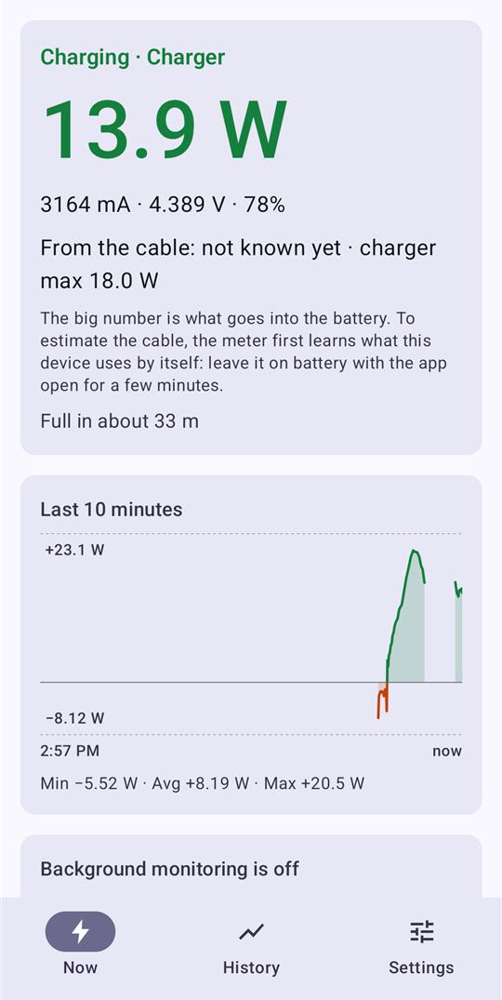
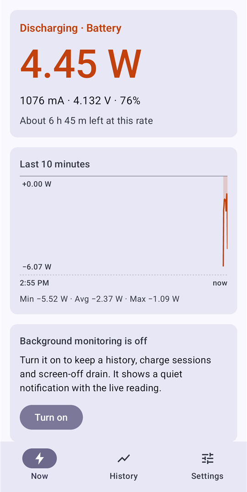
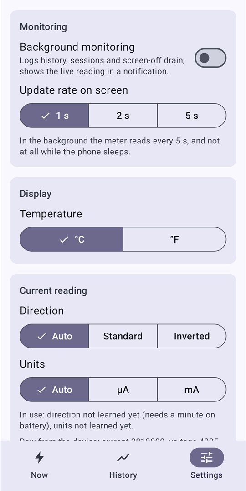

# Power Meter

**A plain, light battery power meter for Android phones and tablets.**
See what your device really takes in and draws: how fast a charger charges, what an app or
standby costs.

### [⬇ Download the latest APK](https://github.com/whatwhatwhoa/MiniApps/releases?q=Power+Meter&expanded=true)

Free, no ads, no account, no tracking. Android 12 or newer. About 2 MB. Part of the
[Mini Apps](../../README.md) series. Its only internet use is checking GitHub for its own updates.

<p>
  
  
  
</p>

---

## Install in two minutes

Do this on the phone or tablet itself.

1. **Download.** Open this page in the device's browser, tap **Download the latest APK** above,
   then tap `PowerMeter-….apk` under *Assets* (the top release is the newest).
2. **Install.** Open the download. If Android says your browser isn't allowed to install apps,
   tap **Settings**, switch on **Allow from this source**, go back, and tap **Install**.
   If Play Protect warns about an unknown app, tap **Install anyway**.
3. **Open Power Meter** from your app list. It starts measuring at once.

**Updating:** when a newer release is out, a note at the top says so: tap **Update to …**.
Android asks before it installs; your history and settings stay. Settings → **Updates** has
**Check for updates** and the once-a-day check (switch it off to stop it).

## Find your way around

Along the top: two tabs, **Power Meter** and **History**, and two icons at the right: the theme
(Auto, Light or Dark) and the gear for Settings. On a tablet each page has two columns.

- **Power Meter:** the live reading. The big number is the power going into the battery (green) or
  coming out of it (orange); under it the average of the last 10 seconds, then current,
  voltage and level, the time to full or empty, a 10-minute chart, the battery's details and
  the session in progress.
- **History:** the last 1 h, 6 h, 24 h or 7 days: power and level charts, each stretch on
  battery or on power, and how fast the battery drains with the screen off.
- **Settings** (the gear; tap it again to go back): background monitoring, how often the screen updates, the average's length,
  alerts, °C or °F, the current reading, how long to keep history, export and clear, updates.

## First steps

1. **Let it learn for a few minutes.** Unplug the device and leave Power Meter open (or turn on
   background monitoring) for a few minutes. It learns what the device uses by itself, which
   it needs to estimate a charger's power.
2. **Turn on background monitoring** if you want history: on the **Power Meter** tab tap **Turn on**, or
   Settings → **Background monitoring**, and allow the notification when asked. A quiet
   notification then shows the live watts; **Stop** in it turns monitoring off.
3. **Plug in.** The **Power Meter** tab shows the power going into the battery, an estimate of what comes
   through the cable, and the charger's rating.

## How do I…

- **…see how fast a charger is?** Plug in and watch the **Power Meter** tab for a minute.
  - The big green number: what goes into the battery.
  - *From the cable ≈ …*: an estimate of what the charger delivers (see *Good to know*).
  - *charger max …*: what the charger says it can give.
  - *Plugged in, still draining*: the charger or cable can't keep up with the device.
- **…see what standby costs?** Turn on background monitoring and leave the device unplugged
  overnight. History → **Screen off** lists each screen-off stretch with its %/h and mA.
- **…see what an app or game costs?** With background monitoring on and the device unplugged,
  use the app for a while, then open History → **1 h**: the power chart shows what it drew.
  For a quick look, the **Power Meter** tab's 10-minute chart and its min · avg · max do the same.
- **…read a point on a chart?** Tap the chart, or drag along it sideways. A bubble shows the
  time and the watts there, and the line under the chart the whole reading (current,
  voltage, level; on History also the temperature). **Clear** puts it away. On History the
  power and level charts show the same moment.
- **…get a steadier number?** The figure under the big number is the average of the last
  10 seconds. Settings → **Average under the big number** sets 5 s, 10 s, 30 s, 1 min or 5 min.
- **…get told when the battery reaches 80%?** Settings → **Alerts** → **Add alert**: Watch
  **Battery level (%)**, **At or above**, Value 80, When **Plugged in**, then **Save**. Alerts
  can also watch charging power, drain or temperature, held **For at least** a time. They need
  background monitoring (saving the first alert turns it on) and notifications allowed.
- **…compare charges?** History → **Sessions**: each charge with its levels, energy in, peak
  and duration.
- **…keep the numbers?** Settings → **Export CSV** saves the log as a spreadsheet file.

## Good to know

- **Measured vs estimated.** Battery power is measured: current × voltage at the battery, the
  net of what the charger gives and the device uses. Android doesn't let apps read the USB
  port's power, so the cable figure adds back the device's own draw (learned on battery) and
  is labeled as an estimate. Until it has learned, it says *not known yet*.
- **Odd readings?** Devices disagree on the current's unit (µA or mA) and on which way is
  "charging". The app learns both on its own. If charging shows as draining, or a number is
  1000× off, open Settings → **Current reading**: it shows the raw value and lets you set
  **Direction** and **Units** yourself, or **Learn again**.
- **It won't drain your battery.** Background monitoring holds no wake lock: while the device
  sleeps, readings pause, and the gap is bridged with the battery's own charge counter.
- **What's kept.** Samples for 1, 7 or 30 days (Settings → **Keep samples for**); sessions and
  screen-off stretches at least 90 days. Everything stays on the device; **Clear history**
  deletes it.

## Building it yourself

Power Meter is built in the [Mini Apps](../../README.md) series repo. With JDK 21 and the Android SDK
(platform 37), from that repo's root:

```
./gradlew :powermeter:assembleDebug
adb install -r apps/powermeter/build/outputs/apk/debug/powermeter-debug.apk
```

`./gradlew :powermeter:assembleRelease` gives a small unsigned APK; sign it with your own key to install it.

Power Meter is open source under the [MIT License](LICENSE).
